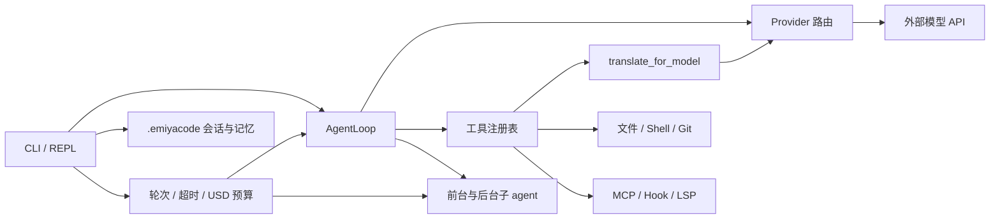

# 架构说明

本文描述 EmiyaAgent 当前实现的主要组件、不变量和信任边界。它面向贡献者和审计者，不是安全沙箱声明。

## 总览

EmiyaAgent 是一个 Python 终端应用。REPL 与一次性 CLI 共享同一套配置、路由、Agent 循环、工具注册表、会话存储和运行控制器；差别主要在交互确认与输出渲染。

箭头表示控制流或数据流，不表示隔离。`API` 和远程 HTTP MCP 位于本机信任边界之外；本地 shell、Hook、stdio MCP、LSP 与子 agent 则继承当前用户权限。

## 分层与职责

### 入口与界面

- `emiya_agent/cli.py` 解析交互/一次性模式、审批覆盖、JSON 输出和全局运行限制，并把终止原因映射到稳定退出码。
- `emiya_agent/ui/repl.py` 组装 Provider、工具、MCP、Hook、LSP、会话、记忆、压缩器和后台任务服务，管理它们的启动与关闭顺序。
- `emiya_agent/ui/commands.py` 实现 `/trust`、`/tasks`、`/checkpoint`、`/fork`、`/hooks`、`/lsp` 等 REPL 控制命令。
- `emiya_agent/ui/json_output.py` 提供 `schema_version = "1"` 的单对象 JSON 与顺序编号 NDJSON 事件；机器输出不能混入 Rich 界面文本。
- `emiya_agent/diagnostics.py` 生成 `/doctor` 与 `emiya doctor` 共用的脱敏诊断报告：只读、不联网、不启动子进程，凭据只报来源。

### 配置与信任

`emiya_agent/config.py` 按以下顺序构建配置：

1. 内置默认；
2. 用户级 `~/.emiyacode/config.toml`；
3. 当前项目已被用户信任时，项目级 `./.emiyacode/config.toml`。

项目配置可以声明模型、provider、MCP 和 LSP server 参数，因此未信任时整层忽略。`trusted_projects`、`tool_approval`、`shell_rules`、外部路径权限、各类环境继承白名单、Hook、LSP 启用状态等键是用户级策略；即使项目已信任也不能覆盖。`/trust` 写入规范化的项目绝对路径，重启后生效。

环境继承采取允许列表。shell、MCP、Hook 和 LSP 从各自用户级白名单构造新环境；stdio MCP 还可以按 server 单独增加变量。白名单是减少意外暴露的机制，不等同于秘密隔离。

### Agent 自主编排、翻译交接与模型路由

REPL 与一次性 CLI 都把普通输入原样交给主 `AgentLoop`。是否直接处理、调用工具或派生 `explore`、`plan`、`general`，由主 Agent 根据任务复杂度、风险和独立并行收益决定；宿主层不根据语言或关键字预先选择 plan，也没有固定的角色调用链。

`ProviderConfig.lang` 与 model 级 `lang` 描述模型的主要指令语言，`Config.model_lang()` 按“model 覆盖 → provider 默认”解析。`translate_for_model` 的工具规格动态展示 executor/explore/plan/general 当前路由与语言；主 Agent 只有在复杂或精度敏感的跨语言交接确有收益时才调用 translator。工具依据目标角色解析权威目标语言，将目标角色、模型路由、语言和原文交给固定职责的 TranslationAgent；调用方不能传入目标语言。TranslationAgent 只做等价语言适配，不规划、不扩写、不执行任务。同语言、短文本和代码为主的交接直接进行。

`executor`、`translator`、`compactor` 与三类子 agent 各自独立路由；因此一次任务可能访问多个 provider。`/route` 或 `/model` 改变下一跳后，翻译工具的下一次规格导出会立即反映新模型语言，而主系统提示词仍保持会话内字节级稳定。

`emiya_agent/providers/registry.py` 将 `provider/model` 路由解析成缓存的客户端实例。Anthropic 协议和 OpenAI 兼容协议分别由 Provider 实现适配，但内部层只接触统一事件与 content block。

外部 provider 请求可能包含系统提示词、会话、工具 schema、文件/搜索/命令结果以及翻译或压缩所需内容。费用预算限制估算支出，不限制数据流向；数据治理必须在路由和 endpoint 层完成。

### 内部消息模型

`emiya_agent/types.py` 的 `Message` 与 content block 是唯一内部消息真源。文本、思考、工具调用和工具结果都以显式块表达；Provider 特有格式只在适配器边界转换。

关键不变量：

- 系统提示词在一个会话中保持字节级稳定，工具 schema 按名称排序；
- 每个 `tool_use` 都有且只有一个匹配的 `tool_result`；
- 并行工具结果合并进同一条 user 消息，并按原调用次序稳定排列；
- 拒绝、取消、中断、参数解析失败和预算终止都不会留下悬空调用；
- 非法 JSON、空 ID 或重复 ID 的不安全助手响应不会执行副作用，也不会进入活跃历史。

这些约束同时保护 Provider 协议正确性、提示词缓存稳定性和会话可恢复性。

### Agent 循环、审批与 Hook

`emiya_agent/agent/loop.py` 驱动模型流、验证工具调用、计算审批、执行工具、合并结果并继续下一轮。审批顺序概括为：

1. 工具静态风险与全局 `tool_approval`；
2. shell 完整命令的首条匹配规则；
3. `PreToolUse` Hook 只允许把决定保持或提高到 `ask`/`deny`；
4. 必要时进行交互审批；
5. 执行工具；
6. `PostToolUse` Hook 可把已完成结果标记为错误，但不能撤销已发生的副作用。

Hook 命令以 argv 直接启动，不经过 shell；stdin 是有界 JSON 事件，stdout/stderr、超时与进程树均受限。多个匹配 Hook 可并发执行，但按配置顺序确定性聚合，优先级固定为 `deny > ask > allow`。

除工具事件外，REPL 与子 agent 还发出生命周期事件：`UserPromptSubmit`（deny 阻止提示词进入历史）、`SessionStart`/`SessionEnd`、`Stop`、`SubagentStop`、`PreCompact`（deny 跳过本轮压缩）/`PostCompact`。只有决策型事件（`PreToolUse`/`PostToolUse`/`UserPromptSubmit`/`PreCompact`）的聚合决策改变控制流；观测型事件仅展示诊断，`matcher` 一律匹配事件主题（工具名、提示词、来源、停止原因或触发方式）。生命周期 Hook 的基础设施错误绝不打断主流程。

审批是授权门，不是沙箱。`auto` 模式只是减少交互，不赋予后台任务超出当前用户权限的隔离。

### 工具、MCP 与 LSP

`emiya_agent/tools` 的工具通过稳定 schema 注册。文件工具默认把解析后的路径限制在工作区，拒绝越界路径和重定向符号链接；写操作默认审批。磁盘与遍历 I/O 通过 `asyncio.to_thread` 避免阻塞事件循环。

MCP manager 在启动阶段连接可信配置中的 stdio 或 streamable-HTTP server，并把远端工具注册为 `mcp__<server>__<tool>`。stdio server 是本地进程；其裸命令只在白名单环境中的绝对 `PATH` 目录解析，连接关闭和子进程生命周期由 MCP SDK 管理，当前没有 shell/Hook/LSP 的 Job Object 或进程组级后代清理保证。HTTP server 是外部数据接收方。MCP 工具仍经过主循环审批和 Hook。

LSP manager 按文件扩展名和优先级选择已安装的 server，不调用包管理器、不自动下载。连接以 server/root 为键按需复用；首次启动在 `ask` 模式下显示解析后的命令和项目根。工具把一基、Unicode 码点列转换为协议位置，限制文档与返回 URI 在工作区内，并对帧、通知、stderr、结果和超时设置上限。查询接口是只读的，但 language server 自身可能加载插件、构建配置或访问网络。

### 子 agent 与后台任务

前台子 agent 使用隔离消息上下文，并按角色获得工具子集：`explore`/`plan` 面向只读调查和设计，`general` 可使用完整能力。父子 agent 共享全局运行控制器，因此模型请求次数、总超时、usage 和 USD 预算不会因派生而重置。

后台任务由有界队列管理并拥有独立取消信号：

- `explore` 和 `plan` 可在共享工作区只读运行；
- `general` 必须使用独立 Git worktree，且仅允许在 `tool_approval = "auto"` 时启动，因为后台任务不能读取 stdin 审批；
- 创建 worktree 前要求源工作区干净，避免遗漏未提交改动；
- 含改动 worktree 默认拒绝清理，只有显式强制操作才删除；
- 内部 Git 命令关闭 hooks、fsmonitor、凭据提示和 LFS 自动下载，并验证被管理路径未被替换或重定向。

worktree 只隔离代码目录和 Git 状态，不是进程、凭据或网络沙箱。

### 会话、检查点与记忆

项目运行时数据统一存放在 `.emiyacode`。会话采用仅追加 JSONL：正常消息和活跃上下文快照保留审计轨迹，恢复时逐条有界解析，单条坏 UTF-8、坏 JSON、未知版本或不完整记录不会破坏其他记录。

新会话先写隐藏临时文件、同步并回读，再以不覆盖方式原子发布。交互会话持有跨进程单写者租约；会话和锁文件拒绝硬链接，相关目录及文件拒绝符号链接/reparse point。恢复会修复完整历史中的悬空工具调用，并以新快照建立一致基线。

命名检查点不可覆盖；分叉把父会话 ID、可选检查点名和初始上下文写入同一条记录。父子后续的追加、清空和压缩完全独立。

项目记忆使用 `.emiyacode/memory` 的索引与独立条目，并沿用工作区、安全路径和审批规则。它是明文持久化，不应存储秘密。

### 全局运行控制

`emiya_agent/agent/control.py` 为一次运行维护单一控制器，执行器、翻译、压缩和所有子 agent 共用：

- 模型请求/轮次上限；
- 以单调时钟计算的总超时；
- 聚合 usage；
- 根据模型配置单价计算的 USD 预算。

启用费用预算但当前路由缺少有效定价时会失败关闭。单个在途请求可能在收到权威 usage 前轻微越过预算；一旦确认达到限制，不再发起后续请求或执行该响应中的工具调用。

## 并发、取消与资源关闭

并发工具调用在准备阶段先完成协议验证、Hook 与审批分类，再执行允许并行的只读调用；需要串行或交互审批的调用保持有序。所有长生命周期组件都必须有显式关闭路径：取消后台任务、关闭 LSP/MCP、释放会话租约，并对 shell、Hook 和 LSP 执行有界的进程树回收。

Windows 使用 Proactor 事件循环和 Job Object；POSIX 使用独立进程组。实现应把“父进程退出”与“整棵进程树已回收”视为不同状态，并在超时、取消、协议错误及正常关闭后执行有界清理。

## 扩展原则

新增 Provider 时，保持内部 content block 不变，把协议差异封装在 Provider 适配器，并测试参数兼容性、流式结束、usage 和拒绝。新增工具时，声明其只读/审批属性、限制输入输出、使用工作区安全路径，并说明它是否启动进程、访问网络或持久化数据。

新增长期运行服务时，应具备：用户可见的启用开关、受信配置来源、解析后的启动预览、环境白名单、并发和资源上限、取消与进程树清理、工作区边界以及可离线测试的 fake 实现。

公共 CLI、退出码、配置结构和 JSON schema 的兼容性要求见 [贡献指南](../CONTRIBUTING.md)。漏洞与边界绕过请按 [安全政策](../SECURITY.md) 私下报告。
